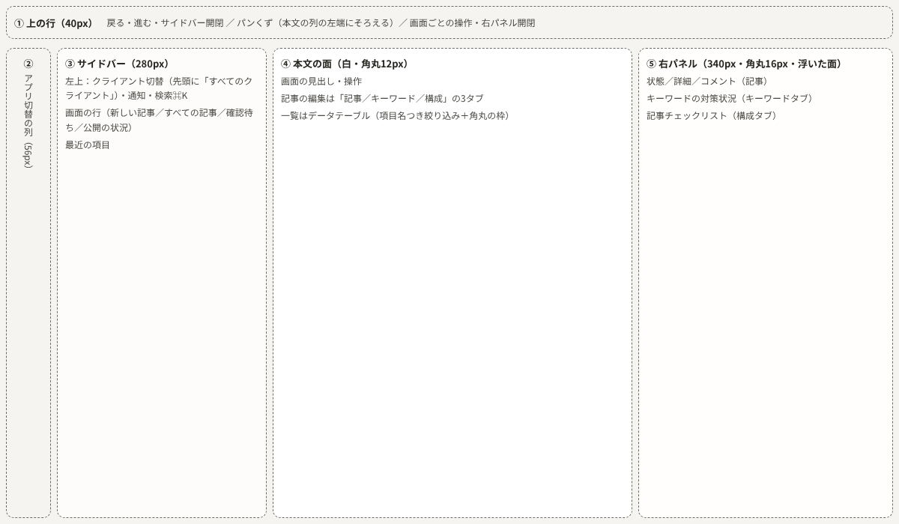

# 共通UIガイドライン v1.0

業務システム（こだまポータル、Scope など）で共通に使う、画面の外枠（AppShell）・色・書体・状態の表し方・部品の方針をまとめたもの。

- 作成：2026-11-03 ／ 決定者：yuuki ／ 最初の適用先：こだまポータル（Studio）
- 更新：2026-11-05 v1.1（こだまポータル仕様 v2.4.2 の承認による。部品の土台を Kedama に変更、入力欄の枠のトークン `border.input` を追加、未検討だった項目を `docs/07_追加.md` に追記。**配置・色・数値は v1.0 から変えていない**）
- 元になった比較：claude.ai のデザインキャンバス「こだまポータル デザイン比較」5段目「Codex型案」
- 2026-11-13：**正（正本）は KedamaDesignSystem リポジトリの `core/guidelines/` に移った**（元の `スラスラスタジオ/ui-guidelines` は写した時点のまま残す。写した元の sha256 は `SOURCE.json`）。以後の変更はこちらで行う

## このフォルダの中身

| 場所 | 内容 |
|---|---|
| `docs/01_原則.md` | 何を大事にするか（落ち着き・色の使い方） |
| `docs/02_AppShell.md` | 外枠の構成と寸法 |
| `docs/03_色と書体.md` | 色・書体・余白・角丸の値と使い分け |
| `docs/04_状態アイコン.md` | 状態の表し方（色はアイコンだけ） |
| `docs/05_部品.md` | Kedama の部品を土台にする方針と、自作する部品 |
| `docs/06_画面パターン.md` | 一覧（データテーブル）と、記事編集の3タブ |
| `docs/07_追加.md` | v1.0 で未検討だったもの（ダーク・スマホ・記事本文・押せる範囲・フォーカス枠・動き） |
| `tokens/tokens.json` | 値の正本（色・書体・余白・角丸・寸法）。docs と食い違うときは tokens が正 |
| `tokens/tokens.css` | 同じ値の CSS 変数（2026-11-13 に、下部にあった他の部品集向けの上書き案を削除。下の「決定事項」参照） |
| `icons/*.svg` | 状態アイコン8種 |
| `images/*.png` | 画面と色見本のスクリーンショット |
| `mockups/*.html` | モックアップの元ファイル（ブラウザで開ける静的HTML） |

## 決定事項（2026-11-03）

| 項目 | 決定 |
|---|---|
| 外枠 | Codex型：左端のアイコン列でアプリを切り替える／サイドバー左上でクライアント（対象）を切り替える |
| 再現の方針 | **この指針を正確に再現する。改変しない**（2026-11-05 yuuki）。変えるときは yuuki の決定を得て、この README に記録する |
| タブ・ステータスバー | 外枠には置かない。移動は 戻る・進む／⌘K／サイドバーの「最近の項目」 |
| 個別の情報 | 右側の浮いたパネルにまとめる |
| パンくず | 本文の列の左端にそろえる |
| 色 | インクと紙の白黒。**色を付けるのは状態アイコンだけ**（Linear型） |
| 書体 | ヒラギノ角ゴ（UI）。読み物の本文に明朝を使うのは任意 |
| 一覧 | データテーブル（項目名つきの絞り込み＋角丸の枠） |
| 部品 | ~~Sparkle Design の部品と余白・角丸・文字サイズの定義を使い、色と書体だけ上書き~~ → **Kedama Design System の部品を土台にし、見た目（色・書体・余白・角丸・寸法）は本指針の値に合わせる**（2026-11-05 yuuki） |
| 入力欄の枠 | **`border.input`＝`#8a8983`**（2026-11-05 yuuki。WCAG 1.4.11 の 3:1 のため。`border.high` は副ボタンの枠として変えない） |
| 正の置き場所 | **KedamaDesignSystem の `core/guidelines/` を正とする**（2026-11-13 yuuki）。元のフォルダは写した時点のまま |
| 純白を使わない | **本文の面（`surface.page`）と副ボタンの地（`action.secondary`）を `#ffffff` → `#fffefc`**（2026-11-13 yuuki）。理由：KedamaDesignSystem 全体の決まり（純白は不使用）に合わせる。状態アイコン（`icons/*.svg`）の白い線も `#fffefc` に直した（色を直した `status-approved.svg`・`publish-failed.svg` は、中身と合わなくなった来歴情報（`<metadata>` の C2PA）を 2026-11-14 に取り除いた。ほかの6つは残す）。`tokens.json` の `contrastOnWhite` は純白の地での値として残す（`$note` 参照）。`images/`・`mockups/` は参考資料として直していない |
| 入力欄の枠（部品での扱い） | ~~`border.input`（`#8a8983`）は値として `core/ui/tokens.css` に置くが、部品の入力欄・選択の枠は当面 `border.high`（`#d6d4cd`）のまま（2026-11-13 yuuki）~~ → **2026-11-14 に見直し（yuuki）: 部品（`core/ui/components.css`）の入力欄・選択の枠を `border.input`（`#8a8983`。本文の面に対し 3.48:1）にする。重ねたとき（hover）に枠の色を変える規則は消し、重ねても枠は変えない**。誤りのときの赤い枠とフォーカスの輪は変えない。手順の番号の丸い枠は入力欄ではないので `border.high` のまま |
| 他の部品集の扱い | `tokens.css` の下部にあった他の部品集（Sparkle Design）向けの上書き案は削除した（2026-11-13）。主ボタンの hover・active は自前の名前（`--ui-action-primary-hover` / `-active`）と自前の決め方（インク色を白へ 12%・黒へ 25% 混ぜる）で `core/ui/tokens.css` に持つ。Sparkle Design は v1.0 のときに参考にした |

## 決まったこと（2026-11-05、こだまポータル仕様 v2.4.2）

- Sparkle Design は使わない（Kedama を部品の土台にする）。ライセンス確認は不要になった
- タブの中の節見出し（例「対策キーワード」「見出しと文章方針」）と、構成タブの「予定タイトル」の値は **14px・600**。モックの 15px は 14px に直した（2026-11-06 yuuki）
- 記事編集で「見たまま編集」を残す。記事タブは「見たまま編集＋HTML 表示（読むだけ）」、Markdown 編集は後の段階（こだまポータル固有）
- キーワード・構成タブは社内（作る側）だけに見せる（MVP。こだまポータル固有）
- ダークモード・スマートフォン表示の方針は `docs/07_追加.md`。ダークの色の値は、yuuki が色見本で確認してから tokens に追記する

## 未決

- ダークの色の値（`docs/07_追加.md`）

## 使い方

- 新しいシステムの画面を作るときは、`docs/` を読み、`tokens/` の値と `icons/` を使う
- 値を変えるときは `tokens/tokens.json` を先に直し、`tokens.css` と色見本の画像を合わせる
- モックアップは `mockups/*.html` をブラウザで開くと見られる（Webフォントが読めない環境では代替の書体で表示される）
