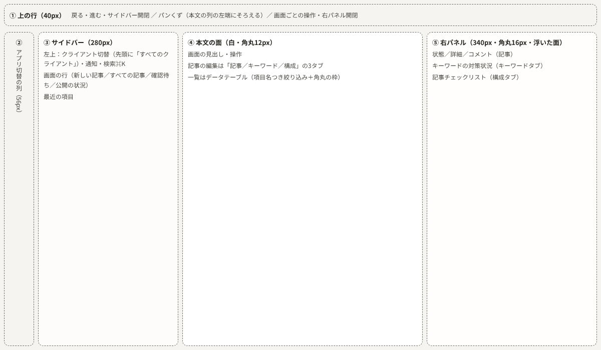

# 02 AppShell（外枠）

| 領域 | 寸法 | 中身 |
|---|---|---|
| ① 上の行 | 高さ 40px・地は `surface.app` | 左：戻る／進む／サイドバー開閉。中：パンくず（**本文の列の左端にそろえる**）。右：その画面の操作（例：プレビュー・公開）、メニュー（…）、右パネル開閉 |
| ② アプリ切替の列 | 幅 56px・項目 40px角・角丸10px | 上からアプリ（例：Studio／Scope／レポート）、区切り線、プラグイン、下端に設定とアカウント。選択中は `surface.selected` |
| ③ サイドバー | 幅 280px・地は `surface.sidebar` | 左上：**クライアント（対象）の切り替え**（プルダウン。先頭に「すべてのクライアント」）・通知・検索（⌘K）。その下に画面の行、「最近の項目」 |
| ④ 本文の面 | 白・枠 `border.middle`・角丸12px | 画面の見出しと操作、内容。左右の余白 24px |
| ⑤ 右パネル | 幅 340px・角丸16px・浮いた影 | 選んだものの詳細（状態／詳細／コメントなど）。開閉できる |

## ルール

- **外枠にタブとステータスバーは置かない**。保存状態などは右パネルか本文の見出しに出す
- アプリ固有のタブ（例：記事編集の「記事／キーワード／構成」）は、本文の面の中に置く
- サイドバーの「画面の行」には、件数（例：確認待ち 1）や異常の印（例：公開失敗の赤いアイコン）を右端に出してよい
- 狭い画面では ②③ を畳み、⑤ は重ねて表示する（詳細は `07_追加.md`）
