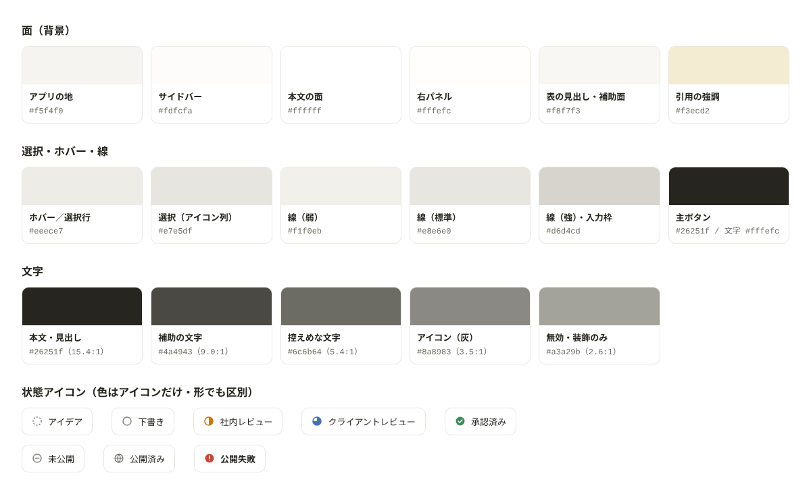

# 03 色と書体

値の正本は `tokens/tokens.json`。CSS 変数は `tokens/tokens.css`。

## 色の使い分け

| 用途 | 値 | 備考 |
|---|---|---|
| アプリの地 | `#f5f4f0` | 上の行・アプリ切替の列 |
| サイドバー | `#fdfcfa` | |
| 本文の面 | `#fffefc` | 2026-11-13 に `#ffffff` から変更（純白を使わない。README の決定事項） |
| 右パネル・入力欄の地 | `#fffefc` | |
| 表の見出し・補助面・選択行 | `#f8f7f3` | |
| ホバー・サイドバーの選択行 | `#eeece7` | |
| 選択（アイコン列）・トグルの押下 | `#e7e5df` | |
| 引用・コメント箇所の強調 | `#f3ecd2` | 唯一の色付きの面 |
| 線（弱・標準・強） | `#f1f0eb` / `#e8e6e0` / `#d6d4cd` | 行の区切り／面の枠／副ボタンの枠 |
| 入力欄の枠 | `#8a8983` | `border.input`（2026-11-05 追加）。白地で 3.5:1。v1.0 は「強」を入力枠にも使っていたが、3:1 に届かないため分けた |
| 文字（本文・補助・控えめ） | `#26251f` / `#4a4943` / `#6c6b64` | 白地で 15.4 / 9.0 / 5.4 : 1 |
| 無効・装飾のみ | `#a3a29b` | 2.6:1。**読ませる文字には使わない** |
| 主ボタン | 地 `#26251f`・文字 `#fffefc` | 主ボタンも色を使わずインク色 |

- 読ませる文字は白地で 4.5:1 以上（`#6c6b64` が下限）
- アイコンや線など文字以外は 3:1 以上（状態アイコンの灰は `#8a8983` で 3.5:1）
  - 状態アイコンをホバー行・選択行に置くと、灰・橙は 3:1 を少し下回る。状態アイコンには必ず文字のラベルを添える（`04_状態アイコン.md`）ので、ラベル付きのアイコンはこの基準の例外とする
- 控えめな文字（`#6c6b64`）は選択行（`#e7e5df`）の上に置かない（4.5:1 に届かない）。選択行では補助の文字色（`#4a4943`）を使う

## 書体

| 用途 | 指定 |
|---|---|
| UI | `-apple-system, BlinkMacSystemFont, 'Hiragino Sans', 'Hiragino Kaku Gothic ProN', 'Noto Sans JP', sans-serif` |
| 読み物の本文（任意） | `'Hiragino Mincho ProN', 'Yu Mincho', 'Noto Serif JP', serif` |

- 文字サイズ：11 / 12 / 13 / **14（基本）** / 16 / 20 / 22 / 28px
- 太さ：400（通常）／ 500 ／ 600（見出し・選択中）／ 700（強調）
- 数字が並ぶ列は等幅数字（`font-variant-numeric: tabular-nums`）、右寄せ
- 中華圏の字形にならないよう、`lang="ja"` を必ず指定する

## 余白・角丸

- 余白：4px 刻み（4 / 8 / 12 / 16 / 20 / 24 / 28 / 32 / 40 / 48）（28 は tokens.json に合わせて追記）
- 角丸：6px（ボタン・入力など小さい部品）／ 8px ／ 10px（表・カード）／ 12px（本文の面）／ 16px（右パネル）
- 影は右パネルなど「浮いた面」だけに使う：`0 1px 2px rgba(38,37,31,.04), 0 4px 16px rgba(38,37,31,.05)`
