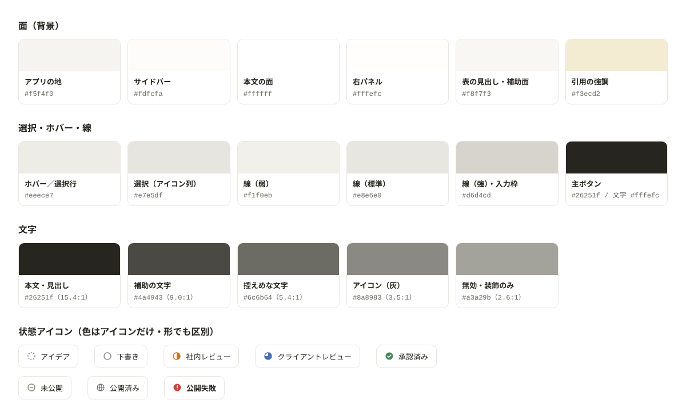

# 04 状態アイコン

**色を付けるのはアイコンだけ**。文字は白黒のまま、太さで強弱を付ける。形でも区別できるようにする（色の見分けが難しい人への配慮）。

## 工程（進み具合）— 円の塗りが進む

| 状態 | ファイル | 形 | 色 |
|---|---|---|---|
| アイデア | `icons/status-idea.svg` | 点線の円 | `#8a8983` |
| 下書き | `icons/status-draft.svg` | 空の円 | `#8a8983` |
| 社内レビュー | `icons/status-internal-review.svg` | 半分塗り | `#c27a1a` |
| クライアントレビュー | `icons/status-client-review.svg` | 4分の3塗り | `#4a6fb5` |
| 承認済み | `icons/status-approved.svg` | 塗りの円＋チェック | `#3f8a5a` |

## 結果（外部との連携など）

| 状態 | ファイル | 形 | 色 | 文字 |
|---|---|---|---|---|
| 未公開 | `icons/publish-unpublished.svg` | 円＋横線 | `#8a8983` | 通常 |
| 公開済み | `icons/publish-published.svg` | 地球 | `#6c6b64` | 通常 |
| 公開失敗 | `icons/publish-failed.svg` | 塗りの円＋！ | `#c4473a` | **太字** |

## ルール

- アイコンは 14〜16px。文字のラベルと横に並べる。アイコンだけで置くときは `aria-label` と、マウスを重ねたときの説明を付ける
- 「何もない状態」（例：未公開）は目立たせない。異常（例：公開失敗）だけ文字を太くし、サイドバーの該当の行にも印を出す
- 他のシステムで状態を増やすときも、**灰＝未着手、橙＝社内で進行中、青＝相手の確認待ち、緑＝完了、赤＝異常** の意味を守る
