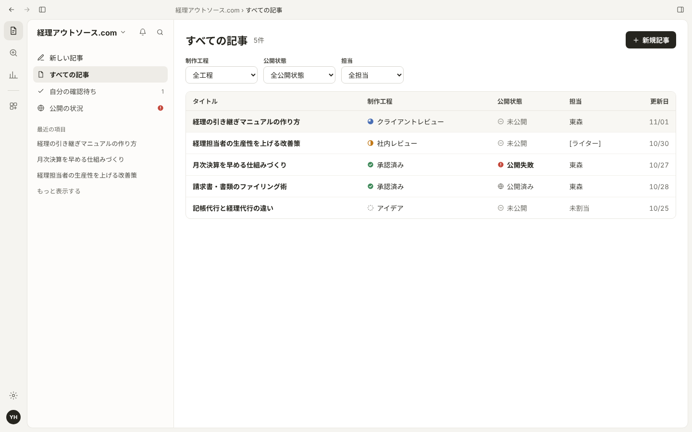
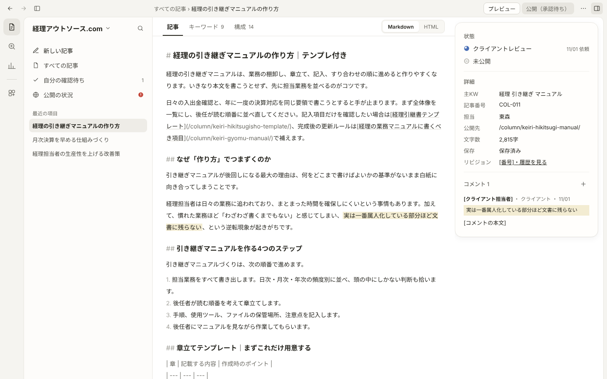
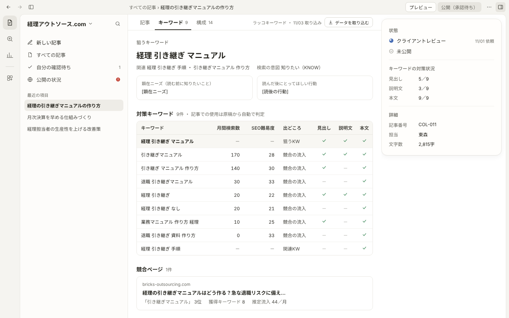
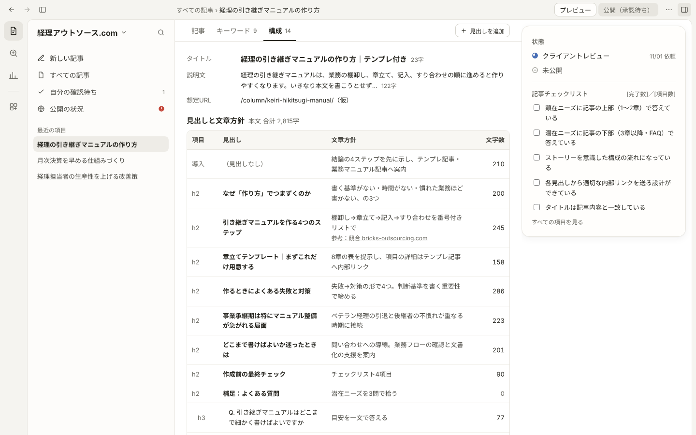

# 06 画面パターン

## 一覧（データテーブル）

- 見出し（22px・600）＋件数（控えめな文字）＋主ボタン（右）
- 絞り込みは**項目名つきのセレクト**を横に並べる（項目名 12px・600、セレクト 高さ36px・角丸8px）
- 表は角丸10pxの枠、見出し行は `surface.subtle`、行の区切りは `border.low`、行の高さ約44px
- タイトル列は太字（600）。状態の列は「アイコン＋文字」。日付・数値は右寄せ・等幅数字
- 対象（クライアント）を左上で選んでいるときは、クライアントの列を出さない

## 記事の編集（3タブ）— こだまポータル固有

本文の面の上部に「記事／キーワード／構成」のタブを置く。右パネルはタブに合わせて中身を変える。

| タブ | 画像 | 内容 | 右パネル |
|---|---|---|---|
| 記事 |  | 見たまま編集・Markdown 編集・HTML 表示（読み取り専用）を切り替え。Markdown の記号（#、| など）は薄い色。※こだまポータルの MVP は「見たまま編集＋HTML 表示」、Markdown 編集は後の段階（2026-11-05 yuuki） | 状態・詳細（保存状態を含む）・コメント |
| キーワード |  | 狙うKW・関連KW・検索意図・ニーズ、対策キーワード表（見出し・説明文・本文で使っているかを✓）、競合ページ、周辺の話題、取り込み | キーワードの対策状況 |
| 構成 |  | 予定タイトル・説明文・URL、見出しと文章方針の表（文字数は本文から計算） | 記事チェックリスト |

- キーワード・構成タブは社内（作る側）だけに見せる（こだまポータルの MVP。2026-11-05 yuuki）
- 使用の✓は緑のチェック、未使用は薄い「－」
- 取り込んだデータには「どこから・いつ」を必ず表示する（例：ラッコキーワード・11/03 取り込み）
